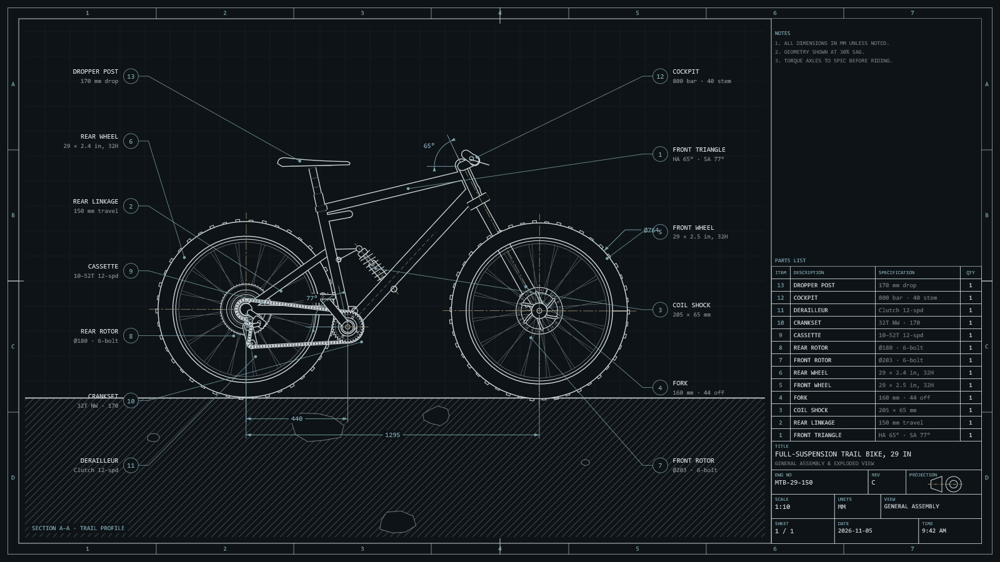
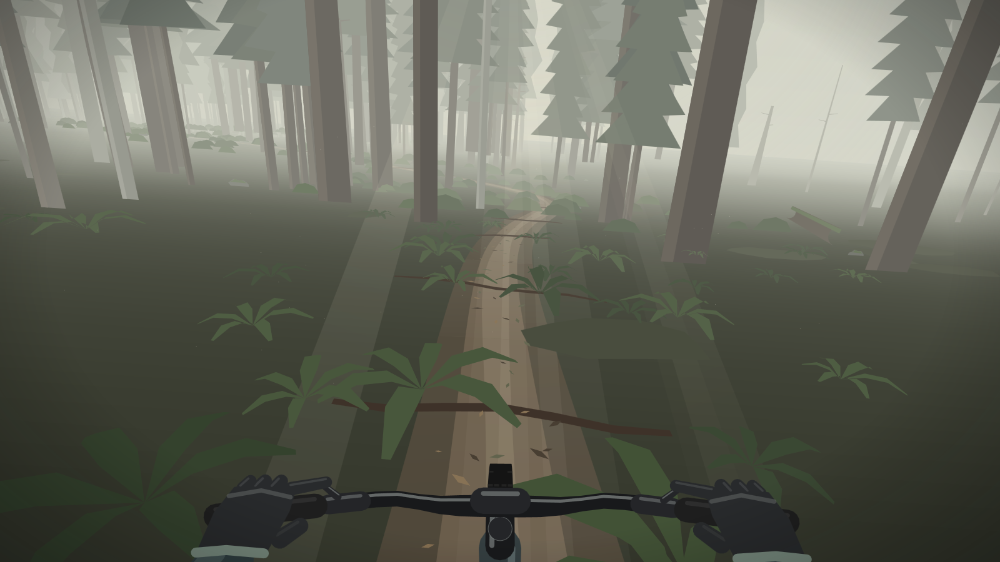

# MTB Screensavers

Mountain-bike screensavers for Windows. Each one is a single native `.scr` file (about 500 KB) that draws with Direct2D and runs on Windows 10 and 11 with nothing else to install.

| | |
|---|---|
| [](screensavers/mtb-cad) | **[MTB CAD](screensavers/mtb-cad)**: a mountain bike drawn as a CAD sheet rides a rough trail, launches off a cliff, hits a boulder, comes apart and rebuilds itself. |
| [](screensavers/forest-ride) | **[Forest Ride](screensavers/forest-ride)**: the view from the saddle, riding singletrack through a misty forest, hands on the bar. |

## Install

1. Download a `.scr` from the [releases](../../releases), or build it yourself (below).
2. Right-click it and choose **Install**. Windows opens Screen Saver Settings with it selected.

Any key press, click, scroll or real mouse movement ends the screensaver. Each one runs on every monitor and draws a simpler view in the small preview in Screen Saver Settings.

## Build

The build uses [llvm-mingw](https://github.com/mstorsjo/llvm-mingw), a self-contained Clang toolchain for Windows targets that runs on Linux, WSL or Windows:

```sh
LLVM_MINGW=/path/to/llvm-mingw ./build.sh                # all screensavers, or put its bin directory on PATH
LLVM_MINGW=/path/to/llvm-mingw ./build.sh forest-ride    # just one
```

Each screensaver is written to `build/`, named after the name Windows shows for it: `MTB-CAD.scr`, `Forest-Ride.scr`. The code is standard C++20 against the Windows SDK, so it should also build with Visual Studio, but that hasn't been tried.

## Layout

- `common/` holds what every screensaver shares:
  - `main.cpp` is the Windows screensaver host. It handles the `/s` (full screen), `/p <hwnd>` (preview) and `/c` (settings) modes, opens a window per monitor, ends the screensaver on input and paces frames to the compositor.
  - `canvas.cpp` is a small subset of the HTML canvas 2D API on top of Direct2D and DirectWrite, including gradient fills.
  - `scene.h` is the interface a screensaver implements.
- `screensavers/<name>/` holds one screensaver:
  - Its `Scene` implementation.
  - A `resources.rc`, whose string 1 is the name Windows shows in the Screen Saver list.
  - Anything else it needs, such as screenshots or a web version.
- `tools/capture.ps1` runs a screensaver in preview mode inside an off-screen window and saves frames as PNGs. Set the `SCREENSAVER_LOG` environment variable to a file path to log startup and per-frame drawing time.

## Adding a screensaver

1. Make a folder under `screensavers/`.
2. In it, implement `Scene` from `common/scene.h`:
   - Define `CreateScene()`, `kSaverName` and `kSaverAbout`.
   - Draw with `Canvas` from `common/canvas.h`, as `screensavers/mtb-cad` and `screensavers/forest-ride` do.
3. Add a `resources.rc` that names the screensaver and includes `../../common/app.manifest`.
4. Run `./build.sh`. It picks up the new folder automatically.

## License

[MIT](LICENSE)
