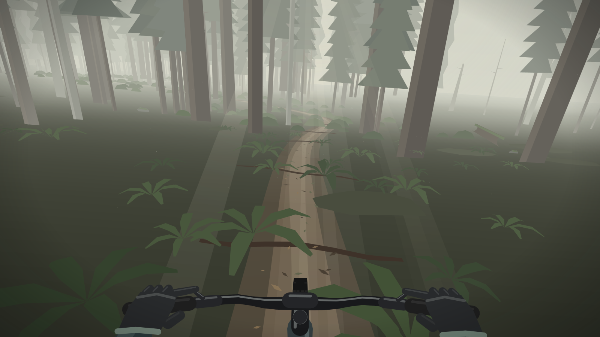
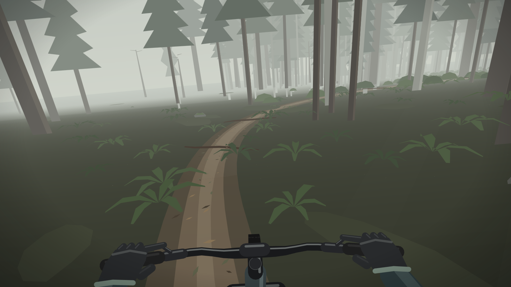
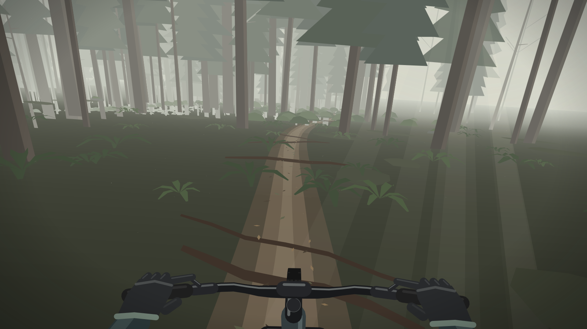
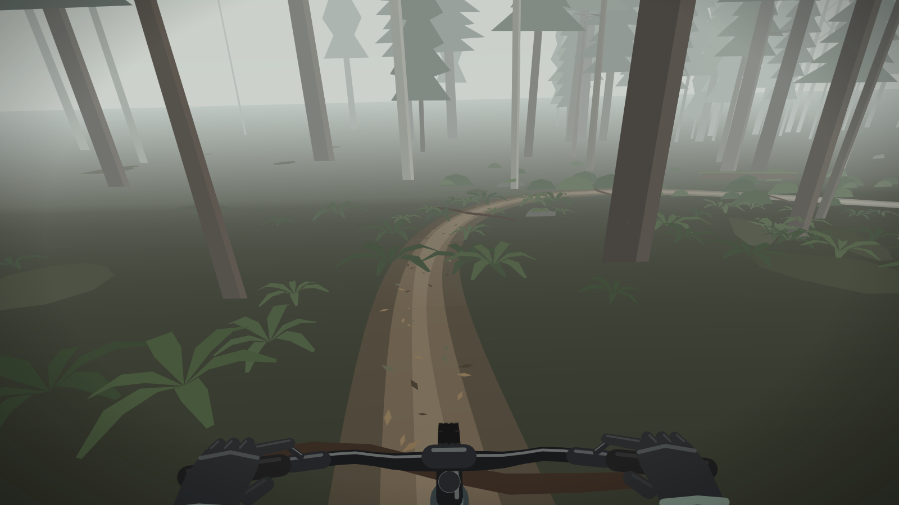

# Forest Ride

The view from the saddle, riding singletrack through a misty forest. The trail winds and rolls downhill forever. The rider leans into the turns, speeds up on the descents and bounces over roots and rocks, and the bar steers and the fork compresses as they go. Each monitor rides its own trail.

| | | |
|---|---|---|
|  |  |  |

## How it works

`ride.cpp` is the whole screensaver.

- **The trail** is a pair of smooth formulas in distance: heading, from sines with mismatched wavelengths so it never repeats, and height, a gentle descent with rolling dips. Its points are added ahead and dropped behind as the rider goes.
- **The forest** is generated in 2 m chunks along the trail, from a seed per chunk:
  - Firs, bare alders and dead snags, kept off the trail where it loops back near itself.
  - Ferns, mossy rocks, fallen logs and patches of moss.
  - Roots and rocks across the trail, which also feed the suspension.
- **Rendering** uses a pinhole camera with a 100° field of view, looking a little down the trail.
  - Everything is a flat shape that fades into fog with distance.
  - The forest floor and the trail use smooth fog gradients. Everything else is grouped into fog bands and drawn back to front, so shapes of the same colour fill together. That keeps a frame to a few hundred Direct2D fills.
- **The cockpit** is a small 3D model in bike space: tyre, fork, frame, stem, bar, brake levers, gloved hands and forearms. It is projected the same way, so steering rotates it about the head angle and fork compression slides the lowers up the stanchions.
- **The ride**:
  - Two spring-dampers: the bars follow the front wheel over bumps, and the rider's head follows more softly.
  - Speed responds to the grade.
  - The lean comes from speed and the curvature of the turn.
