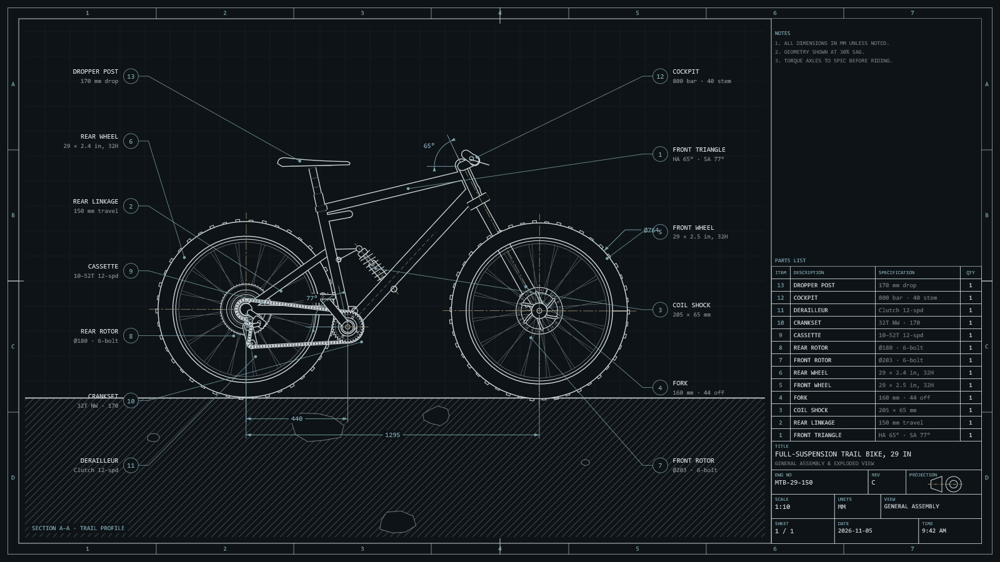
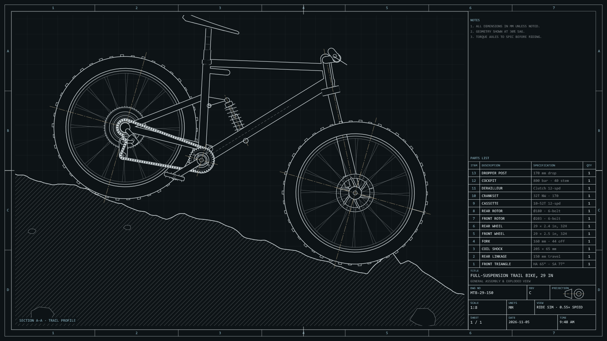
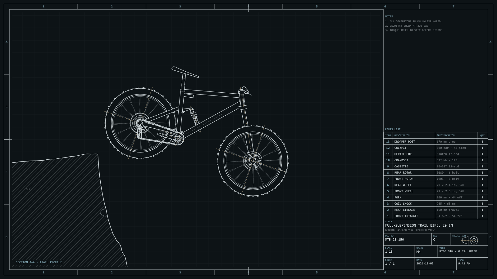
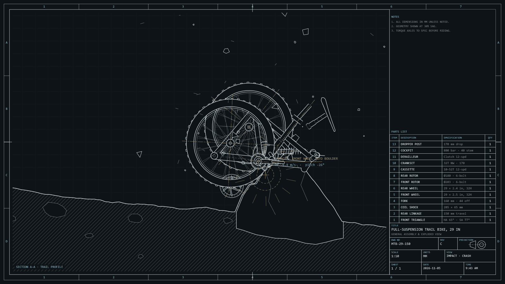
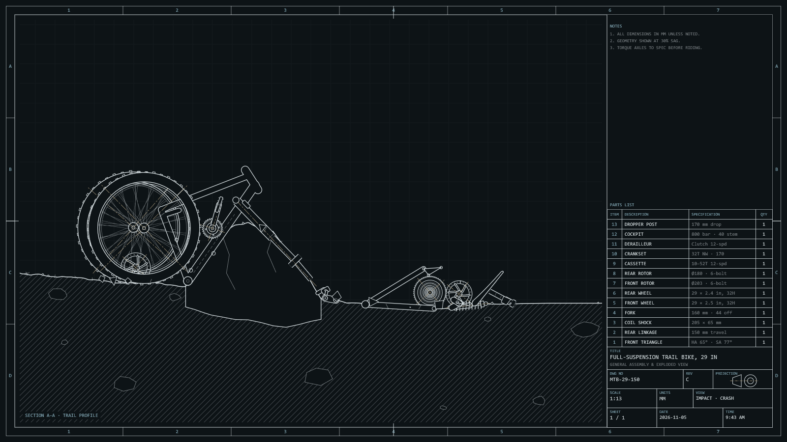

# MTB CAD

A full-suspension mountain bike drawn as a CAD sheet, labelled and dimensioned. It rides a rough trail on working suspension, picks up speed down a chute, launches off a cliff and hits a boulder. The bike comes apart, the parts land on the ground, and then it rebuilds itself and rides on. Each monitor rides its own trail.

| Ride | Drop | Impact | Wreck |
|---|---|---|---|
|  |  |  |  |

## How it works

- `saver.cpp` is the whole animation. It contains:
  - The bike geometry: a 29er with a 65° head angle and 160/150 mm of travel.
  - A two-spring suspension model.
  - The generated trail, cliff and boulder.
  - The crash physics and the CAD sheet.

  Units are millimetres and seconds.
- `web/index.html` is the original version of the same animation, as a single web page. Open it in a browser. `saver.cpp` is a port of it and keeps its structure and names.

If [IBM Plex Mono](https://github.com/IBM/plex) is installed, the labels use it; otherwise they use Consolas.
